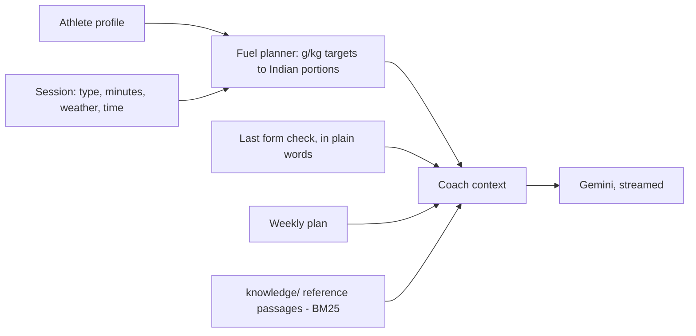
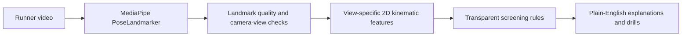

# SportsAI+ / Stridewise v2.0
### AI-Powered Athletic Performance Analysis · RNSIT Final Year AIML Project

---

## Project Structure and Intended Architecture

```
sportsai_v3/
├── frontend/          React + TypeScript + Vite + MediaPipe (browser)
├── backend/           FastAPI + Python AI pipeline
├── ai/                Biomechanics rules, coaching templates, and legacy experiments
└── storage/           Runtime data (auto-created, gitignored)
```

---

## Quick Start

```bash
cd frontend
npm install
copy .env.example .env.local      # then paste your GEMINI_API_KEY
npm run dev:all                   # web app + coach server
# Open http://localhost:5173
```

`npm run dev:all` starts Vite and the small Node server (`server.mjs`, port 8787) that talks to Gemini. Without a key the app still works: the coach answers from the athlete's calculated plan.

## What the app does

Four screens, one profile:

| Screen | What the athlete gets |
|---|---|
| **Today** | Today's session from the weekly plan, a 4-line food & water summary, latest form score, quick question to the coach |
| **Food & water** | For any session (type, length, weather, start time): what to eat, how much and when — before, during, after — plus water in ml/glasses. Gram targets stay hidden behind "Show the numbers" |
| **Form check** | MediaPipe pose analysis in the browser, explained in simple English: one thing to fix first, all six checks, foot landing, 2-week drills, voice playback, PDF |
| **Coach** | Streaming Gemini chat that knows the profile, today's plan, the week and the last form check |

Profile and form-check history are stored in the browser (`localStorage`). There are no accounts and no cloud database.

### How the coach works



1. `src/lib/fuel.ts` turns sports-nutrition ranges (carbs 1–2 g/kg before, 30–60 g/h during, ~0.3 g/kg protein after, 5–7 ml/kg water before, 400–900 ml/h during by weather) into household portions: idlis, cups of rice, katori dal, glasses of water. Diet type and "foods to avoid" are applied here.
2. That plan is the athlete's ground truth. The coach is told to use those amounts and to adjust them with the same rules when the athlete changes something.
3. Passages from `frontend/knowledge/` are retrieved per question and passed as **background reference only**. Food values from the Kaggle Indian Food Nutrition dataset are added only when the athlete asks for numbers (calories, protein in X, etc.).
4. The coach answers in short, simple Indian English with quantities and timing. If the configured model is busy (503/429), the server retries and falls back to other Flash models.

### Data sources

- `frontend/knowledge/nutrition/` — sports-fuel timing, Indian runner nutrition, curated athlete foods
- `frontend/knowledge/form/` — gait, injury prevention and drill notes
- `frontend/knowledge/dataset/Indian_Food_Nutrition_Processed.csv` — [Kaggle Indian Food Nutritional Values Dataset (2025)](https://www.kaggle.com/datasets/batthulavinay/indian-food-nutrition), CC BY-SA 4.0

### Runtime architecture (form check)



The video never leaves the device. The offline GRF research model below is a separate path and is not called by the app.

### 3D landing model

`frontend/public/models/` holds two files from the [three.js examples](https://github.com/mrdoob/three.js/tree/r170/examples/models/gltf):
- `human.glb` — the Ready Player Me sample avatar, reshaped at load time into an elite distance runner (`src/lib/athlete.ts`: slimmer build, gold singlet and racing shorts, race bib)
- `Soldier.glb` — a Mixamo character used only for its "Run" animation, which `src/lib/retarget.ts` retargets onto the avatar at load time

### Python video backend

The FastAPI backend in `backend/` is no longer called by the web app. Its components are experimental (see the table below) and duplicated the browser analysis, so they were removed from the interface.

## Current Research ML Model

The reproducible offline research module is in [`research/`](research/README.md). It downloads the processed tables for 39 runners from a CC BY 4.0 public running-biomechanics dataset, then trains and evaluates a model to estimate the dataset's vertical ground-reaction force from laboratory-derived lower-limb joint angles. Validation holds out whole participants with grouped cross-validation.

The current locked evaluation reserves eight participants before model selection. Participant-balanced Histogram Gradient Boosting was chosen by four-fold subject-grouped validation on the other 31, then scored once on the held-out cohort: **R² 0.958, MAE 1.263 N/kg, RMSE 1.732 N/kg** across 1,668 samples. The kinematic Ridge baseline scored R² 0.903 and MAE 2.071 N/kg. A paired test comparison found participant weighting made no clear difference versus unweighted HGB; a predeclared feature ablation found that a 12-input center-point model had similar error to the 48-input full model. These results use processed lab motion-capture data, not phone video, MediaPipe landmarks, injury outcomes, or clinical measurements. They do not validate the estimator for the frontend. See [`research/RESULTS.md`](research/RESULTS.md) and the machine-readable [locked evaluation](storage/results/grf_model/holdout_evaluation.json).

## Existing Optional Backend Prototype

The FastAPI upload/report path is separate from this research model. Its legacy MotionBERT-shaped network is trained on synthetic skeletons, its ST-GCN wrapper is a peak-finding heuristic rather than a graph-convolution network, D-S fusion receives duplicated evidence, and its RAG response is template-generated. These components are experimental and must not be presented as validated ML or force-plate measurements. The backend also uploads the video when enabled; the browser-only path keeps video processing local.

---

## Environment Variables

```bash
# frontend/.env.local — server-side only, never prefix with VITE_
GEMINI_API_KEY=YOUR_GEMINI_API_KEY
# Optional: GEMINI_MODEL=gemini-3.8-flash
```

---

## Honest Assessment of AI Components

| Component | What it actually is |
|---|---|
| MediaPipe PoseLandmarker | Real pretrained ML — Google BlazePose |
| Research GRF estimator | Histogram Gradient Boosting trained on public processed biomechanics data; laboratory kinematic inputs only; participant-held-out evaluation |
| Legacy “MotionBERT” transformer | Synthetic-data toy model; not a validated 3D pose lifter |
| Legacy D-S fusion | D-S-like confidence math, but current pipeline duplicates its input evidence |
| Legacy “ST-GCN” | Ankle trajectory peak heuristic, not a graph-convolution model |
| Frontend running analysis | 2D geometry/statistics and heuristics on landmark positions |
| MKI Score | Weighted composite formula — not ML |
| Coach Engine | Rule-based if/else |
| Fuel planner | Deterministic rules: consensus g/kg ranges converted to Indian household portions |
| AI coach | Gemini with the athlete's profile and calculated plan as ground truth; BM25 retrieval over `knowledge/` as reference only |
| Browser foot-strike screen | Landmark-based contact heuristic; not force-plate ground truth |
| Backend stride length / contact time | Heuristic estimates, not calibrated measurements |

---

## Project Contribution and Limitations

1. A reproducible participant-held-out benchmark for vertical GRF estimation from gait-cycle kinematic signals.
2. A participant-balanced training comparison and joint/temporal-context ablation showing that fewer kinematic inputs can retain similar error on this dataset; the small held-out cohort and absent external validation limit the claim.
3. A working browser-side running screen as a separate, non-clinical product prototype.

The public dataset has no ordinary phone video, so it cannot establish image-to-GRF performance. A valid end-to-end video model needs a suitable paired dataset or a new synchronized video/motion-capture study with appropriate ethics approval.

---

## Data and Privacy Notes

- Upload IDs used — filesystem paths never exposed to clients
- File size limit: 500 MB
- Input validation: extension, MIME type, minimum resolution, duration
- The browser-only experience analyzes video locally. When the optional backend is enabled, the selected video is uploaded for server-side processing.
- The public dataset is downloaded to `storage/datasets/` and verified against publisher-provided MD5 checksums; cite the source and follow its CC BY 4.0 attribution terms.

*SportsAI+ · RNSIT · AIML Department · 2026*
